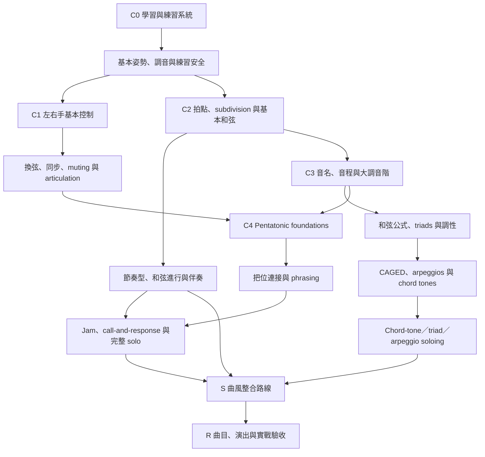

# 吉他學習先備地圖 V0

## 用途與邊界

本文件先定義能力順序，不直接宣稱某支影片已是最佳教材。個別影片仍需 difficulty、prerequisites、transcript 與 visual evidence。

器材 E 不放入同一條吉他核心主線，而在需要時支援各階段。Bass 已由使用者指定延後另案整理，目前只保留隔離分類。

## 核心先備關係

## 階段定義

### Stage 0｜建立可持續的練習環境

- 調音、坐／站姿、基本放鬆與器材安全
- 每日練習結構、節拍器與錯誤紀錄
- 完成標準：能在不疼痛、不過度用力的情況下完成短練習

### Stage 1｜動作與時間感

- 左右手基本控制、換弦、簡單 muting
- 四分、八分、十六分與三連音的拍點
- 基本開放和弦、power chord 或單音 riff
- 完成標準：能在固定 BPM 連續演奏並保持乾淨

### Stage 2｜指板與和聲基礎

- 音名、音程、大調音階與調性
- triad／基本和弦公式
- minor／major pentatonic 的單一核心指型
- 完成標準：知道所彈的根音、音階／和弦功能，而不是只背格數

### Stage 3｜導航、伴奏與音樂化

- CAGED 或選定的一套指板導航法
- 和弦進行、groove、分解和弦與節奏變化
- pentatonic 把位連接、bend、slide、vibrato 與 motif
- 完成標準：能在 backing track 中維持節奏並產生短而完整的樂句

### Stage 4｜依和弦選音與完整即興

- arpeggios、chord tones、triads 與 voice leading
- call-and-response、空間、發展與段落結構
- jam session 與完整 solo
- 完成標準：能說明關鍵選音與和弦的關係，並錄下可重複評估的演奏

### Stage 5｜曲風與曲目整合

- 依 Blues、Rock、Funk、Jazz、Neo-Soul 等路線補充語彙
- 完整歌曲、riff、solo、伴奏與編曲
- 完成標準：完成可演出或錄製的曲目，並能把其中技巧移植到新情境

## Stage 3 展開

Stage 3 不採「看完所有 C3 再進 C4」的線性方式，而拆成指板地標／triads 的共同基礎，再讓 arpeggio／chord-tone 與 pentatonic／phrasing 並行，最後在和弦落點即興合流。進階 rhythm 與曲風作分支，modes 延後選修，速度與 economy picking 作需求式技術支援。

完整模組、出口能力與第一批核心候選見 [STAGE_3_FRAMEWORK_V0.md](../curriculum/stage-3/STAGE_3_FRAMEWORK_V0.md)。

## 曲風與曲目如何接入

- 曲風 S 不是 Stage 0 的替代品；每條曲風都要明列 C1–C4 先備。
- 曲目 R 可在早期作動機與小型驗收，但完整版本應放在相關能力之後。
- 同一支曲目影片可以引用多個能力模組，但只在全域主檔維護一次。
- backing track 可同時是 C2 節奏任務與 C4 即興任務，網站應提供不同練習指令。

## 影片排序規則

1. 概念定義排在要求使用該概念的練習之前。
2. 慢速、單一變因排在多技巧整合與速度挑戰之前。
3. 單一把位排在全指板與多系統比較之前。
4. rhythm／time 基礎不能被 solo 興趣支線完全跳過。
5. 純展示、Shorts 與 inspiration 不可成為唯一核心教材。
6. 多套互斥系統只選一套作主線，其餘標為 alternative／reference。
7. 每個模組以可觀察的 completion check 結束，再進入下一節點。

## 下一版需要的證據

- ~~將 295 支已分類影片映射到 Stage 0–5。~~ 已建立 [STAGE_MAPPING_V1.md](../curriculum/STAGE_MAPPING_V1.md)，另保留 2 支 Pending。
- Stage 1／2 已完成逐支本機處理，詳見 [STAGE_1_CURRICULUM_V1.md](../curriculum/stage-1/STAGE_1_CURRICULUM_V1.md) 與 [STAGE_2_CURRICULUM_V1.md](../curriculum/stage-2/STAGE_2_CURRICULUM_V1.md)。
- 為每支核心候選補 level、prerequisites 與 completion check。
- 找出每個節點的重複教材與缺口。
- 以 transcript × visual Double Check 驗證核心候選，而不是平均分析所有影片。
- 根據使用者目前程度、樂器、曲風與每日時間選出實際起點。
